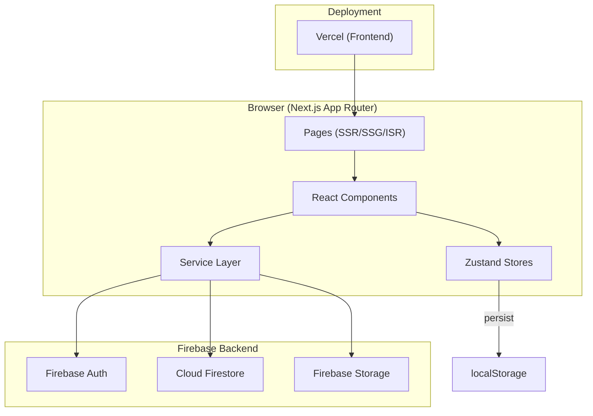
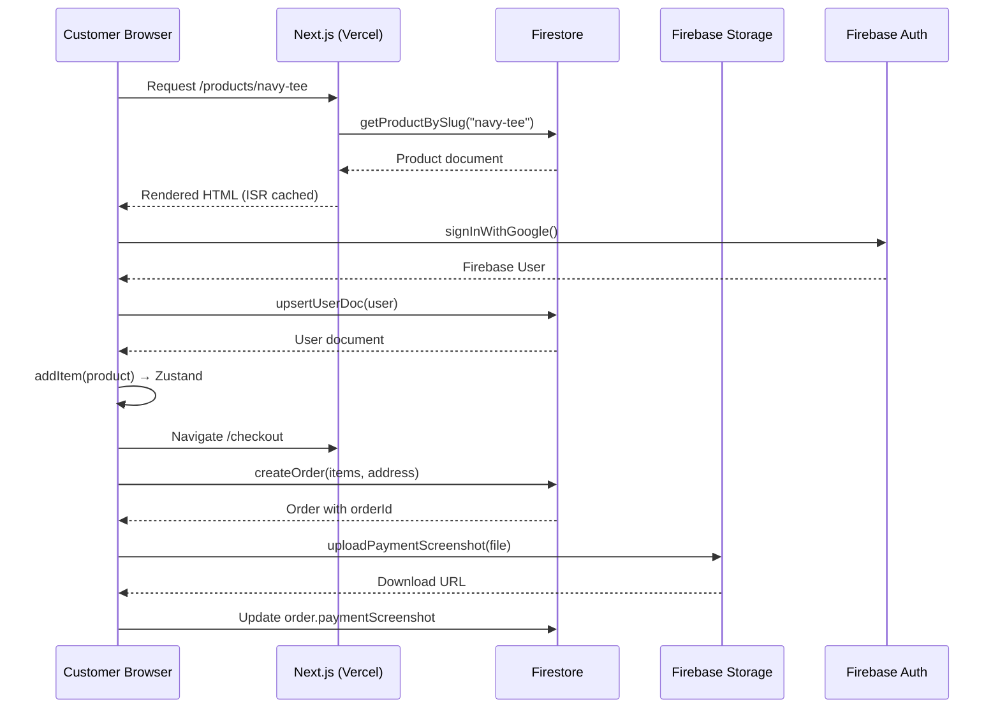
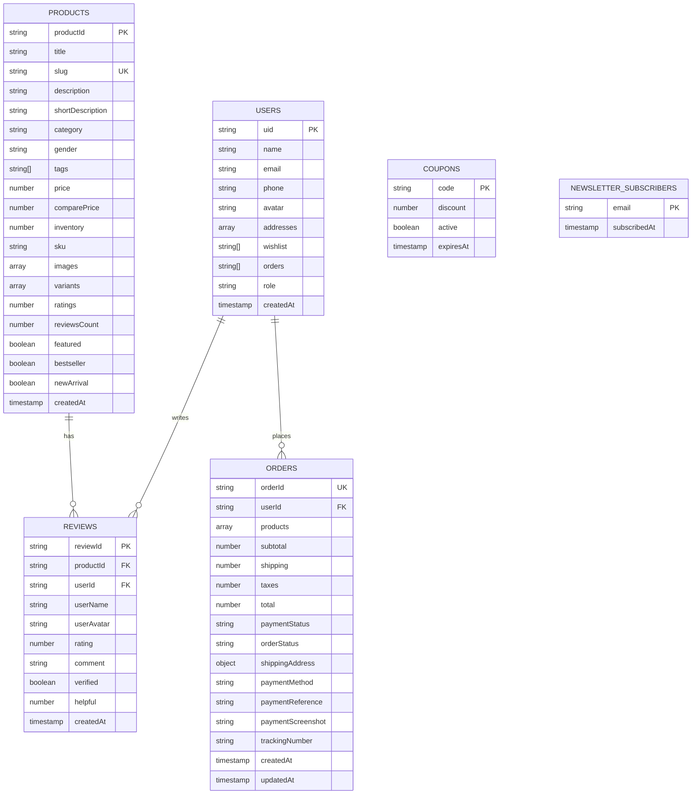

# Design Document — Wefton Copper Premium E-Commerce Platform

## Overview

The Wefton Copper platform is a premium Indian fashion e-commerce application built on Next.js 15 (App Router) with Firebase as the backend-as-a-service. The platform serves two user personas: **Customers** who browse, purchase, and manage orders, and **Admins** who manage products, verify payments, and track revenue.

The existing codebase provides a scaffolded architecture with pages, components, services, stores, and types already in place. This design documents the architecture that ties these pieces together and addresses the implementation gaps: Firestore coupon lookup, review UI, UPI QR environment variable configuration, admin product CRUD with image upload, newsletter Firestore integration, and real-time admin dashboard updates.

### Key Design Decisions

1. **Client-side state with Zustand + localStorage persistence** for cart and wishlist, with Firestore sync for authenticated users (cross-device persistence).
2. **Lazy Firebase initialization** to avoid SSR build errors when environment variables are not configured.
3. **ISR (Incremental Static Regeneration)** for product pages with 3600s revalidation, balancing freshness with performance.
4. **QR-based payment flow** (UPI) with manual admin verification — no payment gateway integration required.
5. **Firestore-backed coupon system** replacing the current hardcoded coupon map, enabling admin-managed promotions without code deployments.
6. **Radix UI primitives** for accessible, unstyled components (dialogs, tabs, sliders) composed with Tailwind CSS.

---

## Architecture

### High-Level Architecture



### Rendering Strategy

| Route | Strategy | Revalidation |
|-------|----------|--------------|
| `/` (homepage) | SSG + Client hydration | On deploy |
| `/men`, `/women` | SSG shell + Client-side data | On deploy |
| `/products/[slug]` | ISR | 3600s |
| `/new-arrivals`, `/bestsellers` | SSG | On deploy |
| `/checkout`, `/account`, `/wishlist` | Client-only (protected) | N/A |
| `/admin` | Client-only (protected, admin) | N/A |
| `/search` | SSG shell + Client-side data | On deploy |
| `/vision`, `/about` | SSG | On deploy |

### Data Flow



---

## Components and Interfaces

### Component Hierarchy

```mermaid
graph TD
    Layout["RootLayout"]
    Layout --> Navbar
    Layout --> Footer
    Layout --> AppProviders
    
    AppProviders --> AuthListener["Auth State Listener"]
    AppProviders --> CartDrawer["CartDrawer (dynamic)"]
    AppProviders --> SearchOverlay["SearchOverlay (dynamic)"]
    AppProviders --> AuthModal["AuthModal (dynamic)"]
    
    subgraph Pages
        Home["/ (HomePage)"]
        Collection["/men, /women"]
        ProductDetail["/products/[slug]"]
        Checkout["/checkout"]
        Account["/account"]
        Admin["/admin"]
        Wishlist["/wishlist"]
        Search["/search"]
    end

    Home --> HeroSection
    Home --> CategoryShowcase
    Home --> FeaturedProducts
    Home --> BrandStory
    Home --> TestimonialsSection
    Home --> NewsletterForm

    Collection --> CollectionPage
    CollectionPage --> FilterSidebar
    CollectionPage --> ProductCard

    ProductDetail --> ProductDetailClient
    ProductDetailClient --> ImageGallery["Image Gallery"]
    ProductDetailClient --> VariantSelector["Variant Selector"]
    ProductDetailClient --> ReviewSection["Review Section"]
    ProductDetailClient --> SimilarProducts["Similar Products"]

    Checkout --> CheckoutClient
    CheckoutClient --> AddressStep["Step 1: Address"]
    CheckoutClient --> PaymentStep["Step 2: QR Payment"]
    CheckoutClient --> ConfirmationStep["Step 3: Confirmation"]

    Admin --> AdminDashboard
    AdminDashboard --> OrdersTab["Orders Tab"]
    AdminDashboard --> ProductsTab["Products Tab"]
    AdminDashboard --> StatsPanel["Stats Panel"]
```



### Store Interfaces

```typescript
// cartStore — manages shopping cart state
interface CartStore {
  items: CartItem[];
  isOpen: boolean;
  couponCode: string;
  discount: number;
  addItem: (item: CartItem) => void;
  removeItem: (productId: string, variantId?: string) => void;
  updateQuantity: (productId: string, quantity: number, variantId?: string) => void;
  clearCart: () => void;
  openCart: () => void;
  closeCart: () => void;
  applyCoupon: (code: string) => Promise<void>; // Changed to async for Firestore lookup
  removeCoupon: () => void;
  getSubtotal: () => number;
  getShipping: () => number;
  getTax: () => number;
  getTotal: () => number;
}

// authStore — manages authentication state
interface AuthStore {
  user: User | null;
  loading: boolean;
  setUser: (user: User | null) => void;
  setLoading: (loading: boolean) => void;
  isAdmin: () => boolean;
}

// wishlistStore — manages wishlist with Firestore sync
interface WishlistStore {
  items: string[]; // productIds
  toggle: (productId: string, userId?: string) => Promise<void>; // Async for Firestore sync
  has: (productId: string) => boolean;
  syncFromFirestore: (userId: string) => Promise<void>;
  clear: () => void;
}

// searchStore — manages search UI state and history
interface SearchStore {
  query: string;
  isOpen: boolean;
  history: string[]; // capped at 5
  setQuery: (q: string) => void;
  openSearch: () => void;
  closeSearch: () => void;
  addToHistory: (q: string) => void;
  clearHistory: () => void;
}
```

### Service Layer Interfaces

```typescript
// productService.ts
getProductBySlug(slug: string): Promise<Product | null>
getFeaturedProducts(count?: number): Promise<Product[]>
getProductsByGender(gender, filters, cursor?): Promise<{ products: Product[]; lastDoc }>
getSimilarProducts(category, excludeId, count?): Promise<Product[]>
searchProducts(query: string): Promise<Product[]>
createProduct(data): Promise<string>
updateProduct(id, data): Promise<void>
deleteProduct(id): Promise<void>

// orderService.ts
createOrder(userId, items, address, discount?): Promise<Order>
uploadPaymentScreenshot(orderId, file, reference): Promise<void>
getUserOrders(userId): Promise<Order[]>
getAllOrders(): Promise<Order[]>
updateOrderStatus(docId, orderStatus, paymentStatus?): Promise<void>

// reviewService.ts
getProductReviews(productId): Promise<Review[]>
addReview(review): Promise<string>
markHelpful(reviewId): Promise<void>

// authService.ts
signInWithGoogle(): Promise<User>
signInWithFacebook(): Promise<User>
signUpWithEmail(name, email, password): Promise<User>
signInWithEmail(email, password): Promise<User>
resetPassword(email): Promise<void>
sendOTP(phone, recaptchaVerifier): Promise<ConfirmationResult>
verifyOTP(confirmationResult, otp): Promise<User>
logout(): Promise<void>

// couponService.ts (NEW)
validateCoupon(code: string): Promise<{ valid: boolean; discount: number; error?: string }>

// newsletterService.ts (NEW)
subscribeNewsletter(email: string): Promise<{ success: boolean; message: string }>
```

---

## Data Models

### Firestore Collections Schema



### Coupon Document Structure (New)

```typescript
interface Coupon {
  code: string;        // Uppercase, e.g., "WEFTON10"
  discount: number;    // Integer percentage 1–100
  active: boolean;     // Admin toggle
  expiresAt: Timestamp | null; // null = never expires
}
```

### Newsletter Subscriber Document (New)

```typescript
interface NewsletterSubscriber {
  email: string;
  subscribedAt: Timestamp;
}
```

### Firestore Security Rules Structure

```
rules_version = '2';
service cloud.firestore {
  match /databases/{database}/documents {
    // Products: public read, admin write
    match /products/{productId} { ... }
    // Users: owner read/write
    match /users/{uid} { ... }
    // Orders: owner create/read, admin read/update all
    match /orders/{orderId} { ... }
    // Reviews: public read, authenticated create (own userId)
    match /reviews/{reviewId} { ... }
    // Coupons: public read, admin write
    match /coupons/{couponId} { ... }
    // Newsletter: authenticated create, admin read
    match /newsletter_subscribers/{docId} { ... }
  }
}
```

---

## Correctness Properties

*A property is a characteristic or behavior that should hold true across all valid executions of a system — essentially, a formal statement about what the system should do. Properties serve as the bridge between human-readable specifications and machine-verifiable correctness guarantees.*

### Property 1: Cart arithmetic invariant

*For any* set of cart items (each with price and quantity), any discount percentage (0–100), and the platform constants (SHIPPING_COST=99, FREE_SHIPPING_THRESHOLD=999, TAX_RATE=0.05), the computed total SHALL equal: `subtotal - discountAmount + shipping + tax`, where `subtotal = Σ(item.price × item.quantity)`, `discountAmount = subtotal × discount / 100`, `shipping = subtotal >= 999 ? 0 : 99`, and `tax = Math.round((subtotal - discountAmount) × 0.05)`.

**Validates: Requirements 19.6, 23.3**

### Property 2: Cart quantity never exceeds inventory

*For any* cart item with a given `inventory` value, after any sequence of `addItem` and `updateQuantity` operations, the item's `quantity` in the cart SHALL never exceed its `inventory` value.

**Validates: Requirements 19.3, 12.2**

### Property 3: Discount percentage calculation

*For any* product where `comparePrice` is set and `comparePrice > price`, the discount percentage SHALL equal `Math.round(((comparePrice - price) / comparePrice) * 100)`. When `comparePrice` is not set or `comparePrice <= price`, the discount percentage SHALL be 0.

**Validates: Requirements 8.2**

### Property 4: Coupon validation logic

*For any* coupon code string, the `validateCoupon` function SHALL return `{ valid: true, discount: N }` only when a Firestore document exists with `code == input.toUpperCase()`, `active == true`, and either `expiresAt == null` or `expiresAt` is in the future. For all other inputs (non-existent code, inactive coupon, expired coupon), it SHALL return `{ valid: false }` with an appropriate error message.

**Validates: Requirements 20.2, 20.3**

### Property 5: Address form validation

*For any* input object, the address Zod schema SHALL pass validation only when: `name` is a non-empty string, `phone` is exactly a 10-digit numeric string, `line1` is a non-empty string, `city` is a non-empty string, `state` is a non-empty string, and `pincode` is exactly a 6-digit numeric string. All other inputs SHALL be rejected with appropriate field-level error messages.

**Validates: Requirements 21.3, 22.5, 22.6**

### Property 6: File upload validation

*For any* file metadata (type and size), the payment screenshot validator SHALL accept only files where `type` is one of `image/jpeg`, `image/png`, or `image/webp` AND `size <= 5 * 1024 * 1024` bytes. All other files SHALL be rejected.

**Validates: Requirements 23.6**

### Property 7: Review form validation

*For any* review submission input, the review Zod schema SHALL pass validation only when: `rating` is an integer between 1 and 5 inclusive, and `comment` is a string with length between 10 and 500 characters inclusive. All other inputs SHALL be rejected.

**Validates: Requirements 15.6**

### Property 8: Search history invariants

*For any* sequence of `addToHistory` calls with query strings, the resulting `history` array SHALL: (a) have the most recent query at index 0, (b) contain no duplicate entries, (c) have a maximum length of 5, and (d) not contain empty or whitespace-only strings.

**Validates: Requirements 32.8**

### Property 9: Sort ordering invariant

*For any* array of products and any sort option (`price-asc`, `price-desc`, `rating`, `newest`, `bestseller`), after applying the sort, every adjacent pair of products `(products[i], products[i+1])` SHALL satisfy the ordering predicate for the selected sort field and direction.

**Validates: Requirements 7.3**

### Property 10: Active filter count

*For any* `FilterState` object, the displayed active filter count SHALL equal the number of fields that differ from their default values (default: `category=[]`, `priceRange=[0, Infinity]`, `rating=0`, `availability=false`, `newArrivals=false`, `bestsellers=false`, `sortBy="newest"`).

**Validates: Requirements 7.9**

### Property 11: Aggregate rating calculation

*For any* non-empty array of reviews (each with a `rating` between 1 and 5), the computed average rating SHALL equal `Σ(review.rating) / reviews.length` rounded to one decimal place, and the star distribution SHALL correctly count the number of reviews at each star level (1 through 5).

**Validates: Requirements 15.2**

### Property 12: Admin revenue statistics

*For any* array of orders, `totalRevenue` SHALL equal the sum of `order.total` for all orders where `paymentStatus == "verified"`, `pendingOrders` SHALL equal the count of orders where `orderStatus == "placed"`, and `pendingPayments` SHALL equal the count of orders where `paymentStatus == "uploaded"`.

**Validates: Requirements 26.1**

### Property 13: Variant availability reflects inventory

*For any* array of `ProductVariant` objects, a size button SHALL be rendered as enabled if and only if at least one variant with that size has `inventory > 0`. A size button SHALL be rendered as disabled (with strikethrough) if and only if all variants with that size have `inventory == 0`.

**Validates: Requirements 11.1, 11.2**

### Property 14: formatPrice locale formatting

*For any* non-negative number, `formatPrice` SHALL return a string that starts with "₹", contains no decimal places, and uses the Indian numbering system grouping (e.g., 1,23,456 not 123,456).

**Validates: Requirements 26.3**

### Property 15: Order status badge color mapping

*For any* valid `orderStatus` value (`placed`, `confirmed`, `processing`, `shipped`, `delivered`, `cancelled`), the badge color mapping function SHALL return exactly one of the defined colors: grey, blue, yellow, purple, green, red respectively. No status value SHALL map to an undefined color.

**Validates: Requirements 29.4**

---

## Error Handling

### Error Handling Strategy

| Layer | Error Type | Handling |
|-------|-----------|----------|
| Firebase Init | Missing env vars | Log warning, return `null` from lazy getters, UI shows graceful fallback |
| Auth Service | OAuth popup blocked | Catch error, display "Please allow popups" message in AuthModal |
| Auth Service | Invalid OTP | Catch `auth/invalid-verification-code`, display "Invalid or expired OTP" |
| Auth Service | Email not found | Catch `auth/user-not-found`, display "No account found with this email" |
| Product Service | Firestore unavailable | Throw, caught by component error boundary, show retry UI |
| Product Service | Product not found | Return `null`, page renders Next.js `notFound()` |
| Order Service | Storage upload failure | Catch, display "Upload failed. Please try again." with retry button |
| Cart Store | Coupon invalid/expired | Set `discount: 0`, display inline error message |
| Newsletter | Duplicate email | Query before write, return "You are already subscribed" |
| Newsletter | Rate limit exceeded | Server-side counter, return 429 with "Too many requests" |
| File Upload | Size/type validation | Client-side validation before upload, display specific error |
| Admin | Non-admin access | Redirect to homepage, Firestore rules reject server-side |

### Error Boundary Strategy

```typescript
// Global error boundary in AppProviders wraps all client components
// Page-level error.tsx files handle route-level errors
// Component-level try/catch for service calls with toast notifications
```

### Graceful Degradation

- **Firebase not configured**: All service functions check for `null` from lazy getters and throw descriptive errors. Components catch these and show "Service unavailable" states.
- **Network offline**: Zustand persisted stores (cart, wishlist) continue working from localStorage. Firestore operations queue and retry when online (Firestore SDK handles this).
- **Image load failures**: All `<Image>` components use `onError` handlers to show branded placeholders.

---

## Testing Strategy

### Testing Approach

This platform uses a **dual testing approach**:

1. **Property-based tests** (using `fast-check` with Vitest) for universal invariants across generated inputs — minimum 100 iterations per property.
2. **Example-based unit tests** (Vitest + React Testing Library) for specific UI behaviors, integration points, and edge cases.
3. **Integration tests** (Firebase Emulator Suite) for Firestore security rules and service layer interactions.
4. **E2E smoke tests** (optional, Playwright) for critical user flows.

### Property-Based Testing Configuration

- **Library**: `fast-check` (TypeScript-native, integrates with Vitest)
- **Runner**: Vitest
- **Iterations**: Minimum 100 per property test
- **Tag format**: `Feature: wefton-copper-platform, Property {N}: {title}`

### Test Organization

```
src/
├── __tests__/
│   ├── properties/           # Property-based tests
│   │   ├── cart.property.test.ts
│   │   ├── coupon.property.test.ts
│   │   ├── validation.property.test.ts
│   │   ├── search.property.test.ts
│   │   ├── product.property.test.ts
│   │   └── admin.property.test.ts
│   ├── unit/                 # Example-based unit tests
│   │   ├── components/
│   │   ├── services/
│   │   └── stores/
│   └── integration/          # Firebase emulator tests
│       └── firestore-rules.test.ts
```

### Property Test Coverage Map

| Property | Test File | What It Validates |
|----------|-----------|-------------------|
| 1: Cart arithmetic | `cart.property.test.ts` | Total calculation correctness |
| 2: Quantity cap | `cart.property.test.ts` | Inventory constraint enforcement |
| 3: Discount calc | `product.property.test.ts` | Percentage badge accuracy |
| 4: Coupon validation | `coupon.property.test.ts` | Firestore coupon lookup logic |
| 5: Address validation | `validation.property.test.ts` | Zod schema correctness |
| 6: File validation | `validation.property.test.ts` | Upload constraint enforcement |
| 7: Review validation | `validation.property.test.ts` | Review schema correctness |
| 8: Search history | `search.property.test.ts` | History state invariants |
| 9: Sort ordering | `product.property.test.ts` | Sort comparator correctness |
| 10: Filter count | `product.property.test.ts` | Badge count accuracy |
| 11: Rating calc | `product.property.test.ts` | Average and distribution |
| 12: Revenue stats | `admin.property.test.ts` | Aggregation correctness |
| 13: Variant availability | `product.property.test.ts` | Size button state |
| 14: formatPrice | `product.property.test.ts` | INR locale formatting |
| 15: Status badges | `admin.property.test.ts` | Color mapping completeness |

### Unit Test Focus Areas

- **Components**: AuthModal flows, CartDrawer interactions, CheckoutClient step navigation, ProductCard rendering variants
- **Services**: Mock Firestore responses, verify correct query construction, error handling paths
- **Stores**: State transitions, persistence behavior, computed value correctness
- **Edge cases**: Empty states, network failures, missing data, boundary values

### Integration Test Focus Areas

- **Firestore Security Rules**: Verify all 9 rule criteria from Requirement 37 using Firebase Emulator
- **Auth flows**: Google/Facebook/Phone/Email sign-in with mocked Firebase Auth
- **Admin operations**: Payment verification, order status updates, product CRUD

